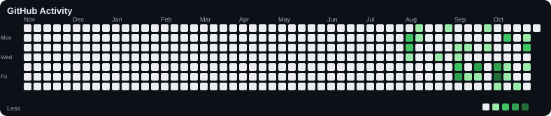

# 👋 Hi, I'm Devi Sri

### Full-Stack Developer | AI/ML Enthusiast | Data Explorer | Software Developer

  
  

  
  
  

---

## 👩‍💻 About Me

I'm a Computer Science & Business Systems student passionate about building practical software and exploring emerging technologies. I enjoy developing full-stack applications, experimenting with AI/ML, working with data, and improving my problem-solving skills through DSA.

- 💻 Building full-stack applications
- 🤖 Exploring AI and machine learning
- 📊 Turning data into useful business insights
- 🧩 Practising DSA with Python
- 🚀 Learning by building practical projects

---

## 🚀 Featured Projects

<table>
<tr>
<td width="50%" valign="top">

### [Campus Connect Hub](https://github.com/Devisri-2409/Campus-Connect-Hub)

A campus collaboration platform for students to discover study groups, share notes, explore events, ask academic questions, and connect with mentors.

**Tech:** React, Express, PostgreSQL, JWT

[🌐 Live Demo](https://campus-connect-hub-theta.vercel.app/) · [💻 Source Code](https://github.com/Devisri-2409/Campus-Connect-Hub)

</td>
<td width="50%" valign="top">

### [OptiCrop](https://github.com/Devisri-2409/OptiCrop)

A machine-learning crop recommendation app that uses soil nutrients and weather-related inputs to suggest suitable crops.

**Tech:** Python, Flask, Machine Learning, Bootstrap

[💻 Source Code](https://github.com/Devisri-2409/OptiCrop)

</td>
</tr>
<tr>
<td width="50%" valign="top">

### [Retail Business Intelligence Dashboard](https://github.com/Devisri-2409/Retail-Business-Intelligence-Dashboard)

An interactive dashboard for exploring retail performance with business KPIs, sales and profit insights, and category/status filters.

**Tech:** Python, Streamlit, MySQL, Plotly

[💻 Source Code](https://github.com/Devisri-2409/Retail-Business-Intelligence-Dashboard)

</td>
<td width="50%" valign="top">

### [AI Resume Analyzer](https://github.com/Devisri-2409/Resume-Analyzer)

An AI-assisted resume analysis project focused on resume feedback, job-description matching, missing skills, and guided learning suggestions.

**Tech:** Python, FastAPI, React, AI/LLM

[💻 Source Code](https://github.com/Devisri-2409/Resume-Analyzer)

</td>
</tr>
</table>

---

## 🛠️ Technologies & Tools

### Languages

### Frontend

### Backend

### Data & AI

 

### Databases

### Tools

---

## 📚 Currently Learning

  
  
  
  
  

---

## 📊 GitHub Statistics

  
  

---

## 📈 GitHub Activity

  

---

## 🏆 GitHub Achievements

  

---

## 🎯 What I'm Looking For

Open to internship opportunities where I can contribute to practical software projects, strengthen my development skills, and explore AI/ML and data-driven solutions.

  
  
  
  

---

## 🌐 Let's Connect

  
  
  
  

### 💡 Building. Learning. Improving. 🚀

